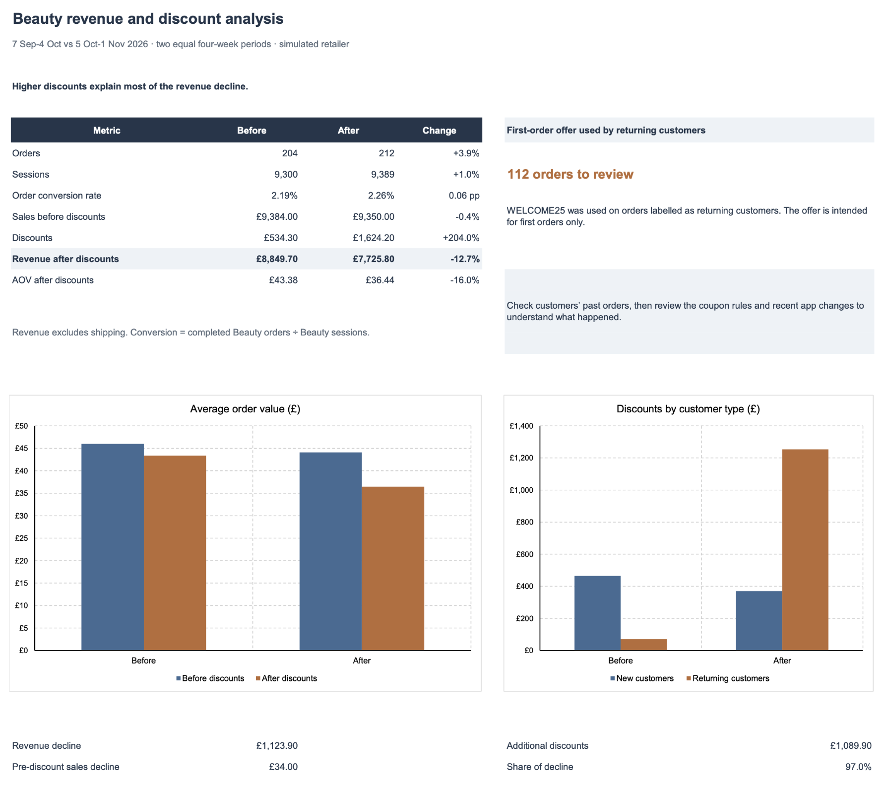

# Beauty revenue and discount analysis

I used Excel to investigate why Beauty revenue fell by **12.7%** at Prism, a fictional retailer used in the iO-Sphere bootcamp.

The main finding was that sales before discounts were almost unchanged, but the retailer gave out much more in discounts. I also found **112 orders marked as returning customers that used a first-order offer**.

[Download the Excel workbook](beauty-revenue-discount-analysis.xlsx)

## What I wanted to find out

Why did Beauty revenue fall between **7 September–4 October** and **5 October–1 November 2026**, and what should the team check next?

The brief gave us a few details to work with:

- **WELCOME25:** 25% off a customer's first order.
- **BEAUTY10:** a 10% discount code sent to members occasionally.
- Beauty prices had not changed during the eight weeks.
- The app was updated on 6 October.

## What I found

| Metric | Earlier four weeks | Later four weeks | Change |
|---|---:|---:|---:|
| Beauty sessions | 9,300 | 9,389 | +1.0% |
| Completed orders | 204 | 212 | +3.9% |
| Order conversion rate | 2.19% | 2.26% | +0.06 percentage points |
| Sales before discounts | £9,384.00 | £9,350.00 | −0.4% |
| Discounts | £534.30 | £1,624.20 | +204.0% |
| Revenue after discounts | £8,849.70 | £7,725.80 | **−12.7%** |
| Average order value after discounts | £43.38 | £36.44 | −16.0% |

Revenue fell by **£1,123.90**. Of that, **£34.00** came from lower sales before discounts and **£1,089.90** from the increase in discounts. That means the extra discounts explain about **97% of the revenue drop**.

Discounts on orders marked as returning customers rose from **£69.80 to £1,253.70**. In the later four weeks, **112 of these orders used WELCOME25**, compared with none before. Those orders received **£1,218.50** in WELCOME25 discounts.

## What I would check next

1. **Check whether these customers really were returning customers.** This would need customer IDs and previous order histories, which are not included in the data.
2. **Check how WELCOME25 is applied.** If the customer labels are correct, why could these orders use a first-order offer?
3. **Look at recent system changes**, including the app update, to see whether they could explain what happened.

The figures show where to investigate, but they do not prove that the app update caused the problem or that customers deliberately misused the code. We also cannot assume the discount amount could be recovered as revenue.

This was a training exercise. No changes were made to a real business, and the data does not tell us about costs, profit or customers' longer-term value.

## How the analysis works

The starting point is to break revenue down into visits, the share of visits that lead to orders, and the average amount paid per order:

**Revenue = sessions × order conversion rate × average order value after discounts.**

The workbook covers **416 completed Beauty orders** and **112 daily session records** split by device. Each period has 28 days. Revenue excludes shipping. The conversion rate is the number of completed Beauty orders divided by visits to Beauty pages.

| Sheet | Contents |
|---|---|
| Summary | Main findings, two charts and suggested next steps |
| Analysis | Comparisons between periods, discount calculations and data checks |
| Orders | Original order data, with added columns for periods and checks |
| Sessions | Original visit data, with an added period column |
| Data dictionary | What each column means |
| Brief | The business question, dates and background |

This version uses **SUMIFS, COUNTIFS, IF, AND and ROUND**. It includes checks for duplicate order IDs, dates outside the comparison periods, and whether sales minus discounts match the recorded revenue. The discount totals are also checked against the breakdown by coupon and customer type.

To see the 112 orders, open **Orders** and filter **coupon_review** to **1**.
